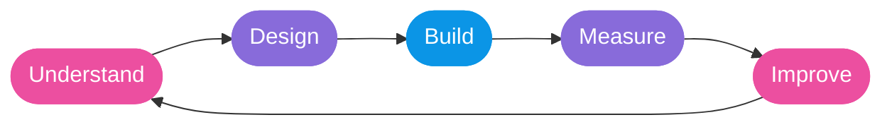

 

## 👋 Hello, I'm Bradley

I'm a UK-based founder who works where business and technology meet. Most of my time goes on taking messy, disconnected processes and turning them into joined-up systems that people actually enjoy using.

That usually means **Salesforce, integrations, automation, websites and product development**, but the tech is only half of it. The bit I care about most is working out the real problem first, then building something that's still useful in three years' time.

> **How I work:** understand the problem → design for the people using it → build with the future in mind.

<table>
  <tr>
    <td valign="top" width="50%">

**🔭 Right now I'm…**
- growing the Apex Infinity family of businesses
- building AI-assisted tools for client teams
- helping organisations get more from Salesforce

</td>
    <td valign="top" width="50%">

**💬 Talk to me about…**
- connecting systems that don't talk to each other
- where automation is (and isn't) worth it
- getting a product idea from napkin to launch

</td>
  </tr>
</table>

## 🚀 What I'm building

<table>
  <tr>
    <td width="33%" valign="top" align="center">
      <h3>🔷 Solutions</h3>
      
Salesforce implementation, integrations and long-term optimisation, making connected business systems work properly.

      <a href="https://apexinfinitysolutions.com"><strong>apexinfinitysolutions.com →</strong></a>
    </td>
    <td width="33%" valign="top" align="center">
      <h3>🟣 Tools</h3>
      
Practical software that removes friction from everyday Salesforce and business workflows.

      <a href="https://apexinfinitytools.io"><strong>apexinfinitytools.io →</strong></a>
    </td>
    <td width="33%" valign="top" align="center">
      <h3>🌐 Digital</h3>
      
Websites, design and marketing that tie creative work back to measurable results.

      <a href="https://apexinfinitydigital.co.uk"><strong>apexinfinitydigital.co.uk →</strong></a>
    </td>
  </tr>
</table>

<!-- Add Thriftmap here once there's a public description and link to share. -->

## 🧩 Problems I like solving

| | |
|---|---|
| 🔗 **Disconnected systems** | Getting platforms and data to work as one |
| ⚙️ **Manual work** | Finding where automation genuinely pays off |
| 🎯 **Complex software** | Turning tricky requirements into clear experiences |
| 💡 **Product ideas** | Taking a concept to something useful and sustainable |
| 🏗️ **Long-term architecture** | Systems that adapt as the business grows |

## 🛠️ Platforms & disciplines

 

<strong>🔁 How I think about building products</strong>

 

Practical experiments, secure foundations, a clear user experience and plenty of iteration.

## 🌱 Beyond the code

Technology is a means to an end. The fun part is finding the right problem, getting the right people round the table and making something that genuinely improves how people work.

Some of my work is public; a lot of it is private while it's being built. This profile shows what I'm ready to share, and there's more on the way.

### Build thoughtfully. Keep learning. Make it useful.

© Bradley Cooper · United Kingdom 🇬🇧

