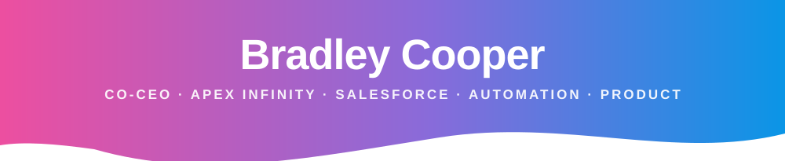
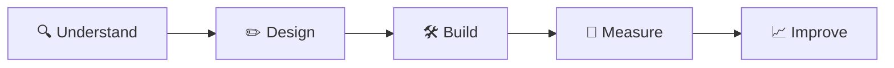

<p align="center">
  
</p>

<p align="center">
  <a href="https://uk.linkedin.com/in/bradleyrcooper"></a>
  <a href="https://apexinfinitysolutions.com"></a>
  <a href="https://apexinfinitytools.io"></a>
  <a href="https://apexinfinitydigital.co.uk"></a>
</p>

---

## 👋 About me


```js
const bradley = {
  role: "Co-CEO & Co-founder",
  company: "Apex Infinity Solutions",
  roots: "South African heritage 🇿🇦, based in Kent 🇬🇧",
  journey: "Financial services → CTO → Founder",
  leads: ["Technology strategy", "Salesforce delivery", "Building great teams"],
  builds: ["Business systems", "Integrations", "Automation & AI"],
  motto: "First who, then what."
};
```

I've spent over a decade in financial services, most of it as **Chief Technology Officer at Harbour Rock Capital**, where I was part of the team from day one. We started out as Salesforce customers trying to make the system fit the way we actually worked. We fixed it ourselves, people noticed, and that turned into **Apex Infinity**.

These days I lead the technology side of the Apex Infinity family. That means helping businesses get far more out of Salesforce, building our own tools, and turning complicated problems into simple, joined-up systems people actually enjoy using.

I'm hands-on and people-first. I'll happily talk strategy with a board and then dig into a flow with the team. I'm also known for translating tech jargon into plain English 😉

<br clear="right"/>



---

## 🚀 What I'm building

<table>
  <tr>
    <td width="33%" valign="top" align="center">
      <h3>🔷 Solutions</h3>
      <p>Salesforce implementation, integrations and long-term optimisation, so connected systems work properly.</p>
      <a href="https://apexinfinitysolutions.com"><b>apexinfinitysolutions.com →</b></a>
    </td>
    <td width="33%" valign="top" align="center">
      <h3>🟣 Tools</h3>
      <p>Practical Salesforce products, from vaults and e-signing to Gantt charts and timesheets.</p>
      <a href="https://apexinfinitytools.io"><b>apexinfinitytools.io →</b></a>
    </td>
    <td width="33%" valign="top" align="center">
      <h3>🌐 Digital</h3>
      <p>Websites, design and marketing that tie creative work back to measurable results.</p>
      <a href="https://apexinfinitydigital.co.uk"><b>apexinfinitydigital.co.uk →</b></a>
    </td>
  </tr>
</table>

---

## 🧭 How I build



| Stage | What it means |
|:--|:--|
| 🔍 **Understand** | Find the real problem and the people it affects before touching a system |
| ✏️ **Design** | Shape it around how the team actually works, not how the software wants them to |
| 🛠️ **Build** | Small steps, quick feedback and secure foundations |
| 📏 **Measure** | Check that it's genuinely saving time, money or headaches |
| 📈 **Improve** | Keep refining, because businesses change and systems should too |

---

## 💼 What I bring

<table>
<tr>
<td width="50%" valign="top">

**🧑‍🤝‍🧑 Leadership**
- Technology strategy & roadmaps
- Building calm, high-trust, flat-structure teams
- Translating business goals into technical plans
- Stakeholder alignment, without the jargon
- Founding & scaling new ventures

</td>
<td width="50%" valign="top">

**⚙️ Technology**
- Salesforce architecture & optimisation
- Integrations & connected data
- Workflow automation & AI agents
- Product design for SaaS tools
- Web platforms & client portals

</td>
</tr>
</table>

---

## 🛠 Platforms & disciplines

<p align="center">
  
  
  
  
  
  
  
  <br/>
  
  
  
</p>

---

## 💬 In other people's words

> *"Bradley is the kind of leader every engineer hopes to work with. During crunch periods, he was the calm in the storm, shielding us from cross-team noise and giving us the clarity and space to focus on solving problems."*
>
> <sub>From a LinkedIn recommendation</sub>

---

## 🌱 Off the clock

- 👨‍👦‍👦 Dad of two little boys
- 📚 *Good to Great* fan: get the right people on the bus first
- ☕ Always up for a chat about blending tech with business strategy

<p align="center"><i>"Build thoughtfully. Keep learning. Make it useful."</i></p>


